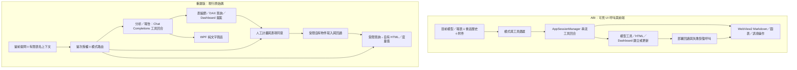

# ABI 功能對齊審查：主畫面、Dashboard 與後端分析鏈路

審查日期：2026-10-14。審查方式：原始碼閱讀、事件綁定追蹤、已安裝 ABI 的靜態證據與使用者截圖對照。

後續進度：第一階段已補入模式入口、記憶體會話與報告文件，詳 [第一階段實作與界線](conversation-step1.md)。本文件保留審查當時的差距，不能當成後續版本的實機驗收結果。

第二階段已接入 AI 模型新增／更新工具與已部署 Dashboard 的讀回／更新／登記流程，詳 [第二階段實作與界線](model-tools-step2.md)。完整 ABI 工具集合與實機行為仍未宣稱等價。

## 1. 結論

**目前不能稱為「功能與後端都完美 1:1」。** 主畫面的外觀，以及 AI 模型清單、範本、權限與提問配置的設定骨架已接近參考；主要操作流程仍有明確缺口。

最關鍵的差距是：

1. AI 只有三個內建工具，尚不能透過內建工具直接完成 ABI 所列的多種模型新增、更新與刪除。
2. HTML 與 Dashboard 模式沒有串接相應的自然語言生成／追問更新鏈路。
3. 下一輪 AI 請求不包含上一輪對話；歷史視窗只保存摘要與檔名索引。
4. 主對話仍是文字呈現，缺少 ABI 的 Markdown、圖表卡片、複製、重試與報告轉換操作。
5. 附件圖示實際開啟 TMDL 資料夾，沒有圖片附件與視覺理解（Vision）流程。
6. 模型合約與 AI 上下文不包含完整的報表頁面、視覺、Power Query、RLS 等脈絡。

這些是實作差異，不是把模型思考等級提高就能補上的問題。現有分層架構可繼續擴充，但需要補齊功能與行為驗收。

本輪只新增審查文件，沒有修改程式、設定、模型或憑證，沒有執行測試、真實 AI 呼叫、DAX 或模型寫入。以下「有實作」代表可追到程式碼，**不等於本輪實機驗收通過**。

## 2. 審查基準與可信界線

### 2.1 重建版

- 專案：本 Git repository 的工作目錄。
- Git HEAD：`795db6b498959b797052bff9629c3509aab999d9`。
- 工作目錄存在已修改與尚未追蹤檔案；本報告審查的是含最新 UI 修改的工作目錄，不是僅該提交。
- 根目錄 `Start-Semantic-Assistant.cmd` 指向 `artifacts\ui-quick-questions-20261014\SemanticAssistant.Desktop.dll`。
- 本輪沒有重新建置或啟動。啟動器路徑核對不能證明每份工作目錄原始碼都已進入該執行檔。

### 2.2 ABI 參考版

安裝目錄：`%LOCALAPPDATA%\Programs\ABI_Assistant`。

| 項目 | 核對結果 |
|---|---|
| 版本 | 5.0.2 |
| Build stamp | 2026-08-27T14:34:46.0940991Z |
| UI DLL SHA-256 | `e56a472a125a2ba7e31f36f8de3c9d5406976d2fb00724cf4456562ac6fc5eb6` |
| Core DLL SHA-256 | `3c1e624b828806b7f75a5f24b29cbdfc6e5a42b135f778c249f57bc4322be6a7` |

雜湊與既有反編譯對象一致，因此沿用相同版本的靜態分析。反編譯資料保留於私人暫存目錄；未將其程式碼加入開源專案。

**ABI 證據索引：**

- **A1**：本機私人暫存中的 `AIAssistant.UI.MainWindow.decompiled.cs`。UI 方法與呼叫可讀，但有混淆狀態機。
- **A2**：`%LOCALAPPDATA%\Programs\ABI_Assistant\WebResources\index.html`。可讀的對話與視覺呈現前端。
- **A3**：本機私人暫存中的 `AIAssistant.UI.SettingsWindow.decompiled.cs`。
- **A4**：使用者提供的主畫面、AI 配置、範本、權限與提問配置截圖。
- **A5**：專案既有 [靜態逆向分析](reverse-analysis.md)、[範本差距分析](report-template-evaluation.md)、[權限差距分析](permissions-parity-analysis.md)。本輪重新讀取相關內容並核對現行來源。

Core 多數方法本體無法可靠反編譯。REA 完整 managed member inventory 也曾受 64 MiB 表示預算限制而 unavailable。不能把服務名稱、工具定義或 UI 呼叫當成原產品所有分支已成功執行的證明，更不能宣稱其內部演算法已等價還原。

### 2.3 判定用語

| 判定 | 意義 |
|---|---|
| 結構對應 | 有相應元件、事件與保存／讀取鏈路；完整行為尚待驗收 |
| 部分對應 | 只涵蓋原功能的一部分，或操作流程不同 |
| 未對應 | 可確認目前實作缺少或用途不同 |
| 自有擴充 | 重建版新增的流程；不計作 ABI 的等價功能 |
| 未知 | 原程式內部、完整目錄或實機行為證據不足 |

不提供「完成百分比」：ABI 的完整功能分母與 Core 覆蓋率尚未確定。

## 3. 優先修正的審查發現

P1 表示影響主要產品能力；P2 表示操作或次要能力差異；P3 表示資訊與外觀差異。本輪未發現足以宣稱資料毀損的 P0 問題。

### F01／P1：AI 內建工具不包含完整模型修改鏈路

現行 `Application/ToolDispatcher.cs:16` 只註冊 `get_table_details`、`execute_dax_query`、`propose_dashboard`。最後一項產生提案，不會寫入模型。`Desktop/MainWindow.xaml.cs:734` 將這個 dispatcher 交給 AI 回合。

ABI A1 的 `GetTools` 可見 `add_measure`（76601）、`update_measure`（75891）、`delete_measure`（76266）、`add_calculated_column`（75960）、`add_calculated_table`（76005）、關係新增／更新／刪除、角色新增／刪除、重新命名、格式字串、隱藏與描述更新等工具定義。是否提供給某個回合仍受模式與權限影響。

重建版確實另有模型寫入器，支援度量值、計算欄位及關係；但這不等於 AI 能使用上述工具。`ModelWriting.cs:60`、`ModelObjectChanges.cs:37` 限制更新為可驗證的自有物件，沒有一般既有物件刪除／重新命名、計算表、RLS 角色等同等操作合約。

**使用者影響：** 主開關勾選後，輸入「幫我建立度量值」仍不能透過內建 AI 工具直接完成。可走 Dashboard 提案／人工計畫，或另行匯入外部工具，但不是同一功能鏈。

**改進：** 建立逐工具的輸入、權限、預覽、寫入、回讀與錯誤合約；先接 `add_measure`／`update_measure`。既有物件修改應另有明確授權與可恢復機制，不能直接移除所有權檢查。

### F02／P1：HTML／Dashboard 按鈕名稱對齊，送出行為未對齊

`Desktop/MainWindow.xaml.cs:322` 的路由是：對話 → AI；HTML → 匯出既有查詢結果；HTML 度量值 → 開啟寫入預覽；Dashboard → 開啟計畫視窗。`SetBusy:814` 在非對話路由停用輸入框。

`DashboardWindow.cs:81` 顯示 JSON 計畫編輯器。AI 提案可從分析／報告回合產生後另開視窗，但 Dashboard 模式本身沒有依輸入需求生成的 AI 回合，也沒有讀取既有 Dashboard 後以自然語言更新的內建工具。

ABI A1 可見 `generate_dashboard_measures`（50922）、`update_dashboard_measures`（50990）、`list_dashboard_measures`（50936）、`get_dashboard_definition`（50954），以及建立／追問模式限定工具、部署驗證及失敗恢復呼叫（詳 A5）。

**使用者影響：** 「切到 Dashboard，輸入需求並送出」與「修改剛才的 Dashboard」不是原版工作流程。

**改進：** 將三種模式接到自然語言入口與結構化產物合約；讓同一需求貫穿生成、預覽、同意、部署、回讀與追問。保留現在的人工計畫為進階檢視。

### F03／P1：跨輪對話上下文與歷史恢復缺失

`Application/ConversationCoordinator.cs:19` 每次 `RunAsync` 建立空訊息集合；該集合只加入本回合工具呼叫與結果。`Desktop/MainWindow.xaml.cs:734` 每次建立 coordinator；`Contracts/Contracts.cs:58` 的請求沒有對話歷史欄位。畫面累積的 `Transcript.Text` 沒有回傳為下一輪訊息。

`HistoryWindow.cs:13` 明示不保存對話；選取紀錄只顯示摘要／報告位置（71 起）。ABI A1 使用 `_conversationHistory`，可見處理歷史為 API 訊息與送入串流鏈的路徑（34983、50451、50683），以及歷史選取、重新命名與刪除（52099、52425、52436）。

**使用者影響：** 追問代名詞、前次比較條件與報告修訂沒有完整前文；重啟後不能恢復對話繼續分析。

**改進：** 建立有角色、工具配對、來源版本、產物引用的會話（Conversation Session）；區分可選永久保存與記憶體中的跨輪上下文。恢復對話不應自動恢復寫入或外送授權。

### F04／P1：報告模式沒有對應的模型提示與圖表呈現

`Adapters.AI/OpenAiCompatibleProvider.cs:70` 的 payload 建構只使用一般分析 system prompt，未按 `request.Mode` 注入專用報告格式。`MainWindow.xaml.cs:754` 將回答追加為文字；776 呼叫 HTML renderer 後未將回傳 HTML 放進畫面，只附加「規格已驗證」文字。

ABI A1 的報告指令（72053、72067）包含管理報告章節與 `viz` 區塊；A2 支援 Markdown、程式碼高亮、KPI／chart／table、訊息複製（1796）、重試（2606）、報告轉換（1831）與圖表圖片處理（1865、2455）。

`ReportSpec.cs:9` 僅有 Table、Kpi、BarChart、LineChart；`HtmlReportRenderer.cs:73` 使用靜態 SVG。尚未對應圓餅／環圈、面積、散點、組合與雙軸等前端結構，也沒有互動圖表與訊息操作列。

**改進：** 定義自有的結構化報告／視覺合約與模式提示，再接嵌入式呈現層。避免照搬 ABI 的私有提示詞或 HTML。

### F05／P1：文字報告轉 HTML 度量值尚未實作

目前 HTML 來源是 `QueryResult → ReportSpec → HtmlReportRenderer`，固定／動態 HTML 度量值亦基於查詢或 Dashboard 計畫。沒有將 AI 已寫出的整篇報告、章節、建議與圖表一同轉為 HTML 的對應鏈。

ABI A1 `TryBuildHtmlReportRequestWithAiAsync`（68819）及 `TextReportToHtmlMeasureConverter` 備援呼叫（72513）支持文字報告轉換能力。Core 的實際轉換品質仍未知。

**改進：** 增加報告文件（Report Document）作為共同內容來源；獨立 HTML 與度量值共用章節／視覺，不要只拿最後一份查詢結果代替報告。

### F06／P1：模型樹展示內容不等於 AI 取得的分析脈絡

`Contracts/Contracts.cs:14`–23 的模型快照包含表、欄位、度量值與關係，沒有報表頁面、視覺配置、Power Query expression、角色／RLS、計算群組等合約。

另外，`ModelContextBuilder.cs:46`–71 只輸出來源與表名，最多 20 表／2000 字元；`ToolDispatcher.cs:83` 的表細節回傳單一 TableDefinition，沒有關係集合。即使模型樹顯示關係，內建 AI 路徑也未提供對應關係上下文或專用讀取工具。

ABI A1 可見 `ExplainPowerQuery`（75042）、`OptimizeDAX`（75145）、RLS 說明與目前報表脈絡參數；雲端連線 UI 另有關聯報表探索（A5）。這不能證明 ABI 能完整分析所有視覺，卻足以確認目前模型合約與入口未對應。

**使用者影響：** 快捷問題「分析所有的視覺化頁面」現在是可保存文字，不是已具備的報表頁面分析能力。AI 可能只分析模型或要求補資料。

**改進：** 分離語意模型快照與報表快照，提供明確可用／不可用能力；加上關係、角色、分割區／M 查詢等按需讀取。報表頁面需另有合法檔案或報表介面來源。

### F07／P2：附件入口用途不同，AI 配置缺少圖片理解

`MainWindow.xaml:211` 的迴紋針直接綁 `OnOpenFolder`；該方法（xaml.cs:146）開啟 TMDL 資料夾並替換模型來源。AI payload 只有文字與工具訊息。

ABI A1 有圖片匯入與移除（64455、64384）、Vision intent 與附件政策；參考 AI 配置截圖有「圖片理解」選項。現行 `AiProfilesWindow.xaml:62`–81 沒有這個選項。

**使用者影響：** 相似圖示表示不同功能，點擊後可能改變資料來源，而不是附加分析參考圖。

**改進：** 真正的附件清單、預覽、移除、類型限制、逐回合外送與多模態 payload；TMDL 開啟維持自己的具名入口。

### F08／P2：快捷問題會重設使用者選定模式

`MainWindow.Shell.cs:64` 的 `FillPrompt` 強制 `ModePicker.SelectedIndex = 0`。若原為報告、HTML 或 Dashboard，`OnModeChanged`（xaml.cs:338）會清除匯入工具與當次授權，並回到分析。

ABI A1 可讀的建議問題處理（64668–64689）是填入文字、聚焦與設定游標；在該分支未見同等模式重設。未執行原版實機測試，故完整模式狀態仍待確認。

**改進：** 填入問題應保留模式；若問題需要另一能力，明確展示該選擇，不能隱式清空操作狀態。

### F09／P2：範本設定骨架對應，完整內容與輸出未證明一致

現行三分頁、版型／配色、保存／取消有對應鏈路；`ReportTemplates.cs:42`–47 的六個版型是自有設計，實際只有 Overview／Sections 兩種布局。截圖沒有展開 ABI 完整選單，不能核定原版總數或全目錄。

目前預覽使用合成資料與自有輸出器；ABI 的文本報告轉換尚缺（F05），也沒有相同內容的產物比較。設定視窗接近不等於輸出的報告一致。

**改進：** 取得各版型的實際輸出樣本後，建立「內容結構＋版型＋配色＋輸出載體」逐格對照；保留自有渲染程式碼。

### F10／P2–P3：語言與其他次要入口未對齊

`MainWindow.Shell.cs:188` 只顯示目前繁體中文訊息，不能切換語言。ABI A1 有自動／中文／英文切換（49604、49609、49614）。關於視窗目前是資訊 MessageBox（191），也不是原版視窗結構。

模型樹目前選取後展示詳情（xaml.cs:138），沒有 ABI 所見的物件解釋、DAX 最佳化、Power Query、RLS 等專用上下文操作。這些內容入口屬能力缺口，不能只用樹形外觀判定等價。

## 4. 主畫面／首頁各組件功能盤點

此處「首頁／儀表板頁面」指使用者截圖中的主視窗；下一節另列 Dashboard 模式子視窗。表格逐入口或緊密相關組件列出，不將純裝飾圖示算成功能按鈕。

| 組件 | 現行路由／效果 | 對齊判定 |
|---|---|---|
| 啟動偵測、連接本地報告 | ContentRendered → DetectStartupReportsAsync → 發現／選擇／載入；可刷新候選 | 結構對應；多報告、無報告、名稱異常及重啟實機未驗收 |
| 報告選擇視窗：選取、連接、刷新、取消 | 選候選、連接所選 catalog；多 catalog 另選 | 結構對應；額外分支不是截圖已證明的原版完整行為 |
| 左側模型名稱 | Desktop 視窗標題解析成顯示名稱；保留內部模型 ID | 結構對應；不是把 GUID 編譯成檔名，標題辨識失敗有 fallback |
| 雲端語意模型 | 自有 MSAL 登入與 workspace／dataset 選擇；另有 XMLA 寫入路徑 | 部分對應；登入設定、報表脈絡及權限流程未等價驗證 |
| AI 配置：新增、選取、編輯、保存、刪除、啟用 | AiProfilesWindow → settings／Windows Credential Vault | 核心清單結構對應；圖片理解缺少，容量 24 組也不與原版候選 10 組相同 |
| 範本：三頁、版型、色卡、保存、取消 | TemplatePreferences → 輸出器 | 部分對應；F05、F09 |
| 範本完整 HTML 預覽 | 合成資料 → 自有 renderer → 瀏覽器 | 自有擴充；不算原版功能驗收 |
| 權限管理：勾選、保存、取消 | AllowModelModification → 共用政策與寫入器防護 | 開關語意有實作；允許後的 AI 寫入能力不完整（F01）；原版所有防護細節未知 |
| 引導式提問：本地／雲端、三欄、保存、取消 | QuickQuestionsWindow → settings → 首頁三按鈕刷新 | 結構對應；未做本輪跨重啟實機驗收 |
| 首頁三個快捷問題 | 從同一份當前來源設定取文字 → FillPrompt | 文字串接有實作；點擊重設模式（F08）；問題2所需頁面能力缺少（F06） |
| 語言 | 僅提示目前繁體中文 | 未對應；F10 |
| 關於 | 開源專案資訊 MessageBox | 部分對應；不需複製原版品牌／授權系統 |
| 最小化、最大化／還原、關閉 | SystemCommands／Close | 基本事件對應；DPI、視窗尺寸及執行中關閉未實機比對 |
| 模型搜尋 | OnSearchChanged → 重建篩選樹 | 結構對應；搜索語意／排序／展開狀態未核定一致 |
| 表／欄位／度量值／關係展開 | TreeView 節點 | 基本結構對應；角色等節點及專用物件操作未對應 |
| 選取模型物件 | 展示 MetadataDetails 頁 | 部分對應；不是原版完整上下文功能 |
| ＋新對話 | 清除當次結果、授權、提問並回歡迎畫面 | 基本入口對應；缺真正會話層（F03） |
| 歷史圖示 | 開摘要與產物索引視窗 | 未對應完整歷史；F03 |
| 輸入與 Enter／送出 | 對話模式可送 AI；其他模式走不同操作 | 分析入口有實作；三輸出模式未等價（F02、F04） |
| 取消 | 取消目前回合／撤銷當次能力 | 有實作；取消已開始的外部寫入不等於立即停止（見權限文件） |
| 迴紋針 | 開啟 TMDL 模型資料夾 | 用途未對應；F07 |
| 報告模式 | AI 一般文字回合＋既有查詢的規格驗證 | 部分對應；無專用模型報告提示／嵌入視覺（F04） |
| HTML 模式 | 匯出現有且有效的查詢結果 | 未對應自然語言 HTML 生成與文字報告轉換 |
| Dashboard 模式 | 開 JSON 計畫子視窗 | 未對應原自然語言建立／追問流程 |
| 分析按鈕 | 回到 Analyze | 自有可見入口；模式呈現不完全一致 |
| 對話內容與訊息操作 | TextBlock 累積文字／事件 | 缺 Markdown、圖表卡片、訊息複製、重試、轉換與圖表操作（F04） |
| 來源與工具／查詢結果／返回對話／關閉側欄 | 自有側面板與頁籤切換 | 自有擴充；不能用它代替原訊息內的產物功能 |
| 數值查詢／匯出／匯入工具勾選 | 當次能力授權 | 自有授權層，與原版單一修改 checkbox 不同 |
| 執行預算、模擬 AI | 限制查詢／上下文／回合；切至 DemoAiProvider | 自有擴充；模擬成功不能代表真實 AI 成功 |
| TMDL／範例／重新讀取／返回示範／雲端登出 | 各來源載入／重讀／清除登入 | 有相應自有實作；原版入口與範圍未完全核定 |
| MCP／清除匯入工具 | 使用者選工具、當次授權與預覽、撤銷匯入 | 部分對應；原版初始化與自動工具供給流程不同，Core 細節未知 |
| 模型修改預覽／Dashboard 計畫／檢視 AI 提案 | 手動或提案 → 驗證 → 分別授權 | 有實作；不是完整 AI 修改工具集合 |
| 結果樣式、匯出離線 HTML | 表／柱／線等受限規格 → HTML 檔案 | 部分對應；沒有完整報告文件或原版圖表集合 |

主畫面事件定位：`Desktop/MainWindow.xaml:110`–258、`MainWindow.Shell.cs`、`MainWindow.DesktopReports.cs`、`MainWindow.xaml.cs`。初始化定位：`Desktop/App.xaml.cs:57`。

## 5. Dashboard 子視窗：每個可操作組件

現行子視窗是「計畫、修改與報告」工具。按鈕有實際 callback，**不是原版 Dashboard 界面的 1:1 復刻**。來源：`DashboardWindow.cs:24`–96、128–235。

| 組件 | 實際功能與條件 | 與 ABI 的差異 |
|---|---|---|
| JSON 計畫輸入 | 手工編輯或載入 AI 提案；修改後重設預覽與同意 | 原版有自然語言生成／追問鏈；目前沒有接在此入口 |
| 1. 檢查計畫並預覽 | 讀定義、核對版本、解析／驗證計畫、生成差異與查詢預覽 | 有相近 preflight 概念；格式／驗證範圍非等價證明 |
| 同意修改＋2. 執行 | 主開關允許且有預覽；核准、寫入、回讀 | 自有逐次同意；僅支援受限自有物件，無完整原版部署註冊表對照 |
| 同意查詢＋3. 執行查詢 | 指標寫入成功後執行受限 DAX、建報告規格 | 流程分段不同；不是立即呈現完整互動 Dashboard |
| 同意匯出＋4. 匯出 HTML | 結果仍新鮮且來源未變；寫本機 HTML | 有自有輸出能力；不是文字報告轉換或原版全版型 |
| HTML 度量值名稱 | 輸入固定／動態 HTML 的目標名稱 | 受限名稱與所有權；對原版命名／管理策略未知 |
| 預覽固定快照 HTML 度量值 | 現有查詢結果 → HTML → ModelWriteWindow | 固定資料，不會因切片器重新計算；不能冒充動態看板 |
| 預覽動態 HTML 度量值 | 驗證已寫入指標 → DynamicHtmlMeasureCompiler → ModelWriteWindow | 最多前100組；需支援 HTML/SVG 的 Power BI 視覺，真實引擎／切片器未驗收 |
| 取消目前操作 | 撤銷此窗授權並取消 token | 有實作；外部寫入取消邊界仍需驗收 |
| 關閉視窗 | 執行中先取消並等待；關閉後釋放訂閱／結果 | 自有生命週期；與原版未做實機比對 |

**共同的重要界線：** 靜態 ABI 證據主要支持「部署 Dashboard 度量值與 HTML」，不證明它建立所有原生 Power BI 報表視覺。我們也沒有由上述按鈕自動建立 Power BI 頁面、視覺容器與切片器的鏈路。因此不能把「產生 Dashboard 度量值」描述為「已完整重建原生報表」。

## 6. 後端分析鏈路對照

ABI 的 Core 內部不透明；上圖不是完整服務內部 call graph，也不是執行成功證明。

| 層級 | 現行實作 | 判定與欠缺 |
|---|---|---|
| 來源發現／識別 | Desktop PID／port／標題、catalog；離線 TMDL；雲端模型 | 基礎有對應；實機邊界與報表脈絡待驗收 |
| 中繼資料（Metadata） | 表、欄位、measure expression、單欄位關係等 | 缺頁面／視覺、M 查詢、角色與計算群組等合約 |
| 上下文建構 | 受限表名摘要＋按需表細節 | 缺內建關係上下文與跨輪對話；ABI 實際完整 prompt 不等價可證 |
| 意圖／模式 | Analyze／Report 共用一般 prompt；HTML／Dashboard 非 AI 路由 | 缺原版專用報告、產物生成與追問操作 |
| AI 供應商 | Chat Completions 相容 HTTP＋串流解析＋工具事件 | 文字工具鏈有實作；vision、多供應商完整相容矩陣未驗收 |
| 工具註冊／政策 | 三內建工具＋人工匯入 MCP＋本機政策 | 與 ABI 大量候選內建工具集合不同 |
| 模型修改 | 自有物件、版本／政策檢查、寫入日誌、回讀、補償 | 核心設計有相近步驟；範圍與原子性無法保證等價 |
| 查詢 | 限列、限大小、限時、結果五分鐘效期 | 有實作；原版全部預算未知，這些屬自有取捨 |
| Dashboard | 一分組維度、最多六指標、受限視覺、手動計畫 | 無內建既有 Dashboard 列舉／定義／自然語言更新工具 |
| 報告輸出 | 最後有效 QueryResult → ReportSpec → 自有 HTML | 缺完整 Report Document 與文字報告轉換 |
| 呈現／匯出 | WPF 文字、離線 HTML、固定／動態 HTML measure | 缺 WebView2 同級訊息與圖表操作；原生報表部署未實作 |
| 設定／歷史 | 多 profile、template／quick question 持久化；摘要索引 | 設定骨架對應；完整聊天存續與恢復不同 |
| 取消／失敗 | token、超時、授權版本、來源版本、受限恢復 | 有自有防護；沒有本輪故障注入，ABI Core 邊界未知 |

## 7. 已有防護是否比較完善？

重建版原始碼可讀、可維護，並且明確實作逐回合外送授權、逐項寫入／查詢／匯出同意、版本核對、自有物件保護與結果到期。這些是可審查的設計優點，應保留。

但**不能因此說功能較完整或已與 ABI 完全等價**：它們有不同操作流程；部分設計限制直接影響功能範圍。原版安全 Core 大多不可讀，也沒有同條件故障驗收，所以不能斷言原版較不安全。

模型修改總開關的桌面路徑有共用政策與寫入器防護，不是單純 UI checkbox。它也不是作業系統級封鎖：其他宿主若直接使用底層 adapter，必須自行接政策。已開始的外部 SaveChanges 不保證取消即停；同一操作的可驗證補償恢復是設計上的例外，詳 [模型權限說明](model-permissions.md)。

原版品牌、付費授權與更新機制不應作為開源替代品的複刻目標。應先凍結要對應的分析與操作行為清單，再將自有擴充列為另外的設計選擇。

## 8. 完成次序與驗收邊界

### 建議第一步：補齊「需求 → 模式 → 會話 → 產物」

先修 F02、F03、F04、F08：讓分析、報告、HTML、Dashboard 都能接收自然語言；保留模式；保留受控跨輪上下文；建立共同的 Report Document／Dashboard 產物引用。否則新增再多工具，按鈕仍無法串成原產品的工作流程。

| 階段 | 交付 | 後續驗收標準 |
|---|---|---|
| 1 | 模式路由、會話與產物合約 | 同一模型下四種需求走對應流程；追問保留前文；切換來源／供應商後重建有效授權 |
| 2 | AI 模型工具與 Dashboard 建立／更新 | 基本 measure 建立／更新、主開關拒絕、版本衝突拒絕、回讀一致、既有 Dashboard 追問更新 |
| 3 | 嵌入報告、圖表與文字轉換 | 同一 Report Document 可在對話、HTML 與度量值保持章節／數字／圖表來源一致 |
| 4 | 附件、報表／M／RLS 脈絡、歷史恢復 | 圖片加入／移除；明確數據來源；重啟恢復內容但不恢復授權 |
| 5 | 完整行為對照與發行 | ABI／重建版相同合成 PBIX、相同供應商條件的操作紀錄；DPI、重啟、取消、錯誤分支與產物逐項核對 |

上表是待執行的驗收計畫，本輪沒有執行。驗收應使用可公開的合成模型與無密鑰證據，避免把私有資料或 ABI 反編譯原文提交到開源 repository。

### 尚不能下結論的項目

- ABI 的完整版型目錄、精確排版、所有工具 allowlist 與各模式預算。
- Core 內部分析策略、DAX 最佳化品質、雲端權限與 rollback 的完整細節。
- 最新重建版在真實 AI／Power BI 引擎的全流程、圖表／切片器與重啟恢復結果。
- 執行中取消、並行外部修改、部分寫入失敗及 policy 切換的同條件行為。

**完成界線：** 本輪完成靜態功能對齊審查與差異清單；沒有完成缺口實作，也沒有證明完整 1:1。下一輪應從階段1的模式／會話鏈路開始。

後續同題回答調查已讀取兩套實際視窗，並修正文字選取／複製及模型關係上下文缺口，詳 [對話與模型脈絡調查](conversation-copy-context-review.md)。這項修正仍不代表所有對話顯示、分析脈絡與操作已完整1:1。
