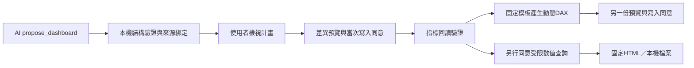

# 動態 HTML 度量值與 AI Dashboard 提案

日期：2026-10-13。程式碼與合成驗證已實作；**未以真實 DAX 引擎、Power BI HTML 視覺或外部 AI 服務驗收**。

## 可以直接操作的流程

1. 雙擊根目錄 `Start-Demo.cmd`，保持合成來源與本機模擬 AI。
2. 保持數值查詢關閉，送出「建立合成Dashboard提案」。右側出現「檢視AI Dashboard提案」。
3. 開啟提案，檢視指標 DAX、分組、日期範圍與視覺；按「檢查計畫並預覽」。此時仍沒有寫入或查詢數值。
4. 勾選當次模型修改同意，執行並回讀驗證指標。
5. 可直接點「預覽動態 HTML 度量值」，不必先查詢資料列。另開寫入視窗展示產生的 DAX，仍須獨立預覽與同意。
6. 固定快照 HTML 與本機 HTML 匯出需要先另行同意數值查詢；它們保存當次 QueryResult。

合成 writer 保存產生的 DAX，驗證寫入／回讀與授權；它**不執行這份動態 DAX**。看到示範成功不能據此判定切片器、日期過濾或 SVG 已在 Power BI 正確運作。

## 動態模板的計算契約

`DynamicHtmlMeasureCompiler.Compile` 輸入已驗證 DashboardPlan、目前 ModelSnapshot、目標表與新 HTML 度量值名稱；輸出 MeasureChange。沒有數值陣列、AI HTML、script 或檔案路徑輸入。

| 項目 | 固定規則 |
|---|---|
| 視覺 | Table、Kpi、BarChart、LineChart；固定 HTML／inline SVG 模板 |
| 分組 | 一個文字、數值或日期欄位；空白分組先列，再依欄位遞增 |
| 顯示上限 | 前100組；TOPN 用明確空白鍵與分組鍵避免空白／零的排序碰撞；超過上限有提示 |
| 指標 | 引用目前模型中與計畫 DAX 完全相同的已回讀指標；本機不代算數值 |
| 週期 | 開始包含、結束排除；CALCULATETABLE＋KEEPFILTERS 與既有篩選取交集 |
| KPI | Sum／Count／First 由使用者計畫明定，僅針對顯示組別；不代表完整母體合計 |
| 空白 | 表格／KPI 顯示「—」，Sum略過空白；圖表不把空白改成零 |
| 分類折線 | 已回傳組別的空白值保留斷點；全指標空白的組別由 SUMMARIZECOLUMNS 省略；不補缺日期，不保證連續時間尺度 |
| 數字 | 指標需為數字或空白，絕對值不得超過10^24；超出時顯示固定提示 |
| 文字 | 標題先 HTML encode 再 DAX quote；動態分組標籤截至256字後跳脫五種 HTML 特殊字元 |
| 輸出限制 | DAX最多8000字；產生內容超過64000字元時回傳固定提示；不截斷 HTML 中間 |
| 碰撞／相依 | 產生欄位的雜湊別名不得撞模型欄／度量值；拒絕 HTML 名稱與指標同名或直接互相引用 |

六個指標／八個視覺是計畫上限；組合超過8000字編譯預算仍會拒絕，請減少視覺或指標。間接循環、無效 DAX、RLS、關係過濾方向、引擎版本及服務端效能需另外驗收。列數與字元限制是輸出邊界，**不是 DAX 引擎 CPU／記憶體或計算時間上限**；摘要表可能先計算所有分組。

HTML fragment 需由支援 HTML／SVG 的視覺呈現。本程式不安裝視覺、不修改 PBIR 頁面；視覺是否允許 style／SVG 尚未驗收。SUMMARIZECOLUMNS 在度量值中的相容性及 SelfValue 過濾語意依實際引擎版本；測試模型應包含日期範圍與跨表切片器情境。

語法依據：[KEEPFILTERS](https://learn.microsoft.com/en-us/dax/keepfilters-function-dax)、[SUMMARIZECOLUMNS](https://learn.microsoft.com/en-us/dax/summarizecolumns-function-dax)、[CONCATENATEX](https://learn.microsoft.com/en-us/dax/concatenatex-function-dax)。這些文件支持模板選擇，不能代替實際引擎計算結果。

## AI 提案契約

- 工具名 `propose_dashboard`，能力為 MetadataRead；外部 provider 還需當回合 Metadata 外送同意。沒有結構外送同意時不提供此工具；偽造呼叫也在核心拒絕。
- 參數只允許 `{ "plan": { ...DashboardPlan... } }`；schema 描述分組／指標／日期／視覺，JSON拒絕未知、重複、缺少必要欄位、數字 enum 及超限。
- 本機驗證表／欄存在、指標名稱／表／DAX大小、日期型別與區間、視覺索引及重複名稱。只驗證結構；DAX語意、既有物件所有權與寫入碰撞留給後續完整定義預覽及引擎。
- 工具結果只有計畫，不包含資料列、寫入授權或寫入結果。資料來源身分與計畫雜湊由桌面宿主產生，不信任 AI 傳入的來源。
- 只有完整成功回合且授權仍有效才把提案提升到桌面狀態。取消、開始新回合、切換來源／供應商、寫入後重新讀取都清除舊提案。
- 開啟與預覽核對來源版本。固定／動態 HTML 的子寫入視窗也保留產生時來源版本；模型變更後禁止以舊模板直接刷新版本重做預覽。
- 提案 hash 用於本機一致性檢查，沒有數位簽章、不能作為寫入授權。所有模型修改仍需另一份一次性 approval。

## 驗證來源與剩餘驗收

- `DynamicHtmlMeasureTests`：四種視覺、三種聚合、日期模板、獨立HTML／DAX跳脫、字元限制、碰撞／來源／直接循環與逐次寫入。
- `DashboardProposalTests`：拒絕結構錯誤、無數值查詢、無寫入、來源／雜湊變更、撤銷能力及示範工具迴圈。
- `AiStreamingTests`：實際自建 loopback HTTP 傳送分片提案 JSON，完整組裝後進入本機 validator；無 Metadata 外送同意時偽造提案不讀模型。
- WPF `--smoke-dashboard`／`--smoke-proposal`：從提案至獨立預覽、三種同意、查詢／匯出、動態 DAX保存／回讀，以及來源變更後拒絕舊子預覽。所有操作只使用自製記憶體模型。

下一步真機驗收必須使用另選的獨立測試模型：驗證空白與負值、日期交集、跨表切片器、超過100組、反向修改造成舊提案失效、HTML視覺呈現、寫入失敗及修復。現有私人 Power BI 模型沒有被本輪連接。
