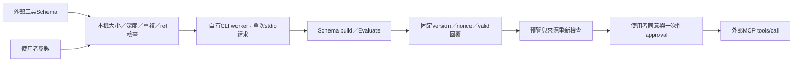

# MCP Schema 子程序驗證

日期：2026-10-13。外部Schema不在桌面程序內執行JsonSchema.Net build／Evaluate。

## 資料路徑

worker透過 `SemanticAssistant.Cli.dll --mcp-schema-worker-v1` 啟動。指令與程序集路徑由宿主提供；Schema／參數不能指定可執行檔、工作目錄、環境或指令。CLI模式在建立任何示範模型／AI流程前分流，只驗證一份JSON後結束。

## 邊界與預算

- schema與參數各最多16000 UTF8 bytes；schema深度32、參數深度16，禁止重複欄位與非fragment遠端ref。
- 一份stdin請求最多64000 bytes，stdout最多512字元。回覆必須匹配固定version與隨機nonce，只有boolean結果；沒有回傳參數、schema、例外或環境值。
- 預設牆鐘期限5秒；CPU總使用預算2秒，每50ms由宿主輪詢。記憶體亦檢查256MiB committed/private量；排程可能造成輪詢超出，**不是即時系統的精確硬限**。
- Windows在傳送資料前加入Job：256MiB process committed memory、最多一個active process、2秒user CPU設定、kill-on-close。Job建立／指派失敗便拒絕驗證。
- Windows Job的CPU時間由系統週期檢查，可能晚於設定值；宿主另作CPU監測和牆鐘取消。測試曾觀察Job單獨處理時超過2秒，已加輪詢預算，沒有把2秒設定當成精確最大消耗。[Microsoft limit資訊](https://learn.microsoft.com/en-us/windows/win32/api/winnt/ns-winnt-jobobject_basic_limit_information)
- 逾時、取消、CPU／memory超出、異常退出或回覆錯誤，都不產生approval；先終止自有helper／關閉Job，再等待退出與排空pipe。cleanup等待有上限，沒有消費晚到結果。
- 非Windows保留子程序／CPU輪詢／牆鐘期限；沒有Windows Job的OS記憶體／active-process保證。此路徑尚未在非Windows驗收。
- helper不繼承API key、MSAL token、MCP自訂env或PATH；只取必要的SystemRoot／WINDIR／TEMP／TMP。stderr排空後丟棄。

Schema registry禁止遠端fetch；沒有宣告dialect時使用Draft2020-12，接受明確的Draft06／07／2019-09／2020-12內建dialect，未知自訂dialect拒絕。測試核對Draft07與2020-12的ref sibling語意。這不是把JSON Schema語法簡化成自行猜測的型別檢查；仍由鎖定的JsonSchema.Net執行，但過於昂貴的有效Schema也可能因預算被拒絕。[JsonSchema.Net建置與dialect文件](https://docs.json-everything.net/schema/basics/)

## 同意與快取

預覽先驗證，成功後才顯示可同意狀態。client保存最多256個validation hash，以catalog version／definition hash／參數hash為key，沒有保存參數內容。重列清單／程序停止使快取失效。

`ApproveAfterUserConfirmationAsync` 重查來源與PermissionSession，再取得或重用結構驗證證據；回傳一次性approval。`CallToolAsync` 核對client、tool、catalog、參數hash、授權快照與期限。快取只避免重複CPU工作，不能授權外部工具或跨來源沿用同意。

修改參數／工具／來源清除桌面舊預覽與舊結果；成功呼叫後清除同意但保留當次文字結果。關閉視窗等待取消與自有程序清理。

## 驗證與限制

`IsolatedSchemaValidatorTests` 實際啟動CLI／自製fixture helper：合法／非法參數、local refs／dialect、遠端ref／重複key拒絕、helper缺少、wall timeout、取消、錯nonce／大回覆、CPU忙迴圈與真正regex schema。驗證known helper PID退出，不掃描使用者其他程序。

WPF smoke亦驗證非法Schema參數不能進入同意，再走合法預覽／逐次呼叫；publish smoke啟動封裝後helper，避免僅在開發bin目錄成立。FixtureHost的CPU／等待模式由本專案自行撰寫，沒有啟動原廠工具。

這些限制只保護自有Schema helper；**外部MCP server仍依目前使用者權限執行，沒有檔案系統／網路沙箱，也不能回復其外部副作用**。使用者先明確設定並啟動程序，再逐次同意工具；協定與一般server相容性仍須獨立驗收。
