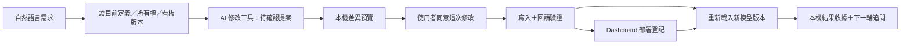

# 第二階段：AI 模型修改與已部署 Dashboard 更新

日期：2026-10-14。承接 [第一階段](conversation-step1.md)，對應 [功能審查](abi-parity-review-20261014.md) 的模型工具與部署更新缺口。

## 已實作的工作流程



工具回覆 `modification_pending` 表示尚未寫入。實際修改在 AI 回合完成後執行，避免對話工具在舊模型版本上查詢尚未建立的物件。原生工具結果不會把「提案成功」偽裝成「寫入成功」。

本輪補入 11 個工具，連同既有 3 個，共 14 個內建工具；不代表 ABI 全部工具已完成。

## 工具清單

| 新增工具 | 功能 | 寫入界線 |
|---|---|---|
| get_model_edit_context | 讀表內自有物件、關係及看板管理狀態 | 唯讀中繼資料 |
| add_measure | 提出新度量值 | 名稱必須尚未存在 |
| update_measure | 提出度量值更新 | 須為完整性有效的自有物件；看板管理物件改走看板更新 |
| add_calculated_column | 提出新計算欄位 | 名稱必須尚未存在；引擎需重算 |
| update_calculated_column | 提出計算欄位更新 | 須為有效自有計算欄位 |
| add_relationship | 提出單欄關係 | 名稱／端點不碰撞；欄位型別需一致 |
| update_relationship | 提出關係更新 | 須為有效自有關係；不更改 RLS 安全篩選 |
| list_dashboard_measures | 列出可辨識的已部署看板與核對狀態 | 唯讀，不執行 DAX |
| get_dashboard_definition | 讀計畫、HTML 定義、Revision 與管理物件 | 更新必須以此版本為依據 |
| generate_dashboard_measures | 提出新看板部署 | 新指標不得接管既有同名物件 |
| update_dashboard_measures | 提出已部署看板更新 | 需正確 dashboard_id、expected_revision，且全部管理物件回讀一致 |

原有 `get_table_details`、`execute_dax_query`、`propose_dashboard` 保留。沒有設定寫入服務的宿主不會把新增模型工具提供給 AI；離線 TMDL 不提供此階段寫入服務。

後續修正另加入不依賴寫入服務的 `get_model_overview`，供所有支援來源唯讀取得模型及關係概覽，內建工具增為15個；詳 [對話與模型脈絡調查](conversation-copy-context-review.md)。本文件其餘內容描述階段2交付。

## 桌面操作

1. 關閉舊版，從根目錄 `Start-Semantic-Assistant.cmd` 或原有中文啟動器開啟本版。
2. 連接 Power BI，設定 AI 供應商；在「權限管理」允許修改資料模型。
3. 分析／報告模式可要求新增或更新物件。例如：

   > 請先核對模型欄位，在適合的表建立 SA_銷售總額，使用正確欄位加總；不要編造欄位名稱。

4. AI 回合結束後顯示「AI 模型修改／Dashboard 部署」差異視窗。核對來源、版本與完整 DAX，再勾選並執行。
5. 關閉視窗後，主畫面重新讀取模型，展示本機結果收據。只有成功且新來源版本吻合，才以該收據接續 AI 會話。
6. 在「來源與工具」點「已部署 Dashboard」查看登記與核對狀態，可選取並填入更新需求。例如：

   > 保留剛才看板的其他內容，把月份銷售圖改為折線圖；請先讀回已部署定義再更新。

7. 看板更新仍會顯示新的差異預覽。舊授權與舊預覽不會沿用。

回答下方保留「檢視 AI 模型修改」入口，便於重新開啟尚有效、尚未執行的提案。提案最長10分鐘，來源版本、修改政策或資料依賴失效時不能使用。

## Dashboard 部署與登記

- 新建／更新同一批寫入包含指標與動態 HTML 度量值，使用同一原生寫入計畫、操作 ID 與回讀驗證。
- 在原有 Dashboard 人工計畫視窗操作，也接入此登記流程；已登記且涉及同一管理物件的計畫會核對更新目標。
- 計畫中的 HTML 度量值由自有編譯器產生；AI 不提供 HTML、CSS、JavaScript 或本機檔案路徑。
- 編譯前使用「預計寫入的度量值定義」投影確認引用；這不是假查詢資料。實際 DAX 接受與數值仍由引擎判定。
- 登記資料保存至 `%LOCALAPPDATA%\SemanticAssistant\dashboard-registry\dashboards.json`：看板 ID、計畫、樣式、HTML DAX、自有物件 expression／operation／integrity 與提交時間。沒有查詢資料列、API key 或 token。
- 讀回時核對完整自有物件譜系（Lineage），不只使用名稱。Power BI 重開後 PID／port 改變，可由完整物件標記與內容辨識既有看板；標記缺失或內容變更時拒絕更新。
- 版本游標為登記內容 SHA-256。更新提案必須傳回讀取得的游標；確認時再檢查，避免覆蓋另一份登記更新。
- 更新保留未修改的計畫內容；從計畫移除指標不刪除其舊度量值，避免破壞其他視覺的引用。最多16個累積管理物件，超過會拒絕而非暗中清理。
- Dashboard 計畫最多六個指標、一個分組維度、可選日期範圍；視覺仍限表／KPI／柱／線。動態 DAX最多8000字、前100組、輸出 HTML最多64000字。
- 部署的是模型度量值與動態 HTML；原生報表頁面、視覺容器、切片器與 HTML/SVG 視覺安裝不由此流程自動建立。

## 失敗、恢復與一致性

| 情況 | 處理 |
|---|---|
| 新增名稱已存在，或更新目標不存在 | 工具拒絕，沒有寫入 |
| 非自有物件／完整性不符 | 拒絕，不接管原報表物件 |
| 一般工具試圖更新看板管理度量值 | 要求改用 update_dashboard_measures |
| 修改總開關關閉／政策切換 | 工具不可用或提案失效；取消相關回合與舊同意 |
| 本回合已有待確認修改，再查詢新物件 | 拒絕查詢，須寫入後另開新回合 |
| 原始查詢／MCP 依賴到期 | 提案不能開始／繼續正常寫入；檢查抵達原生儲存前 callback |
| 引擎寫入／回讀失敗 | 使用既有 coordinator 嘗試補償，回讀結果與 partial failure 明確呈現 |
| 登記檔版本未知、損壞、過大或被鎖定 | 保存原檔；沒有開始看板模型寫入 |
| 模型已回讀成功，但登記保存失敗 | 不重試模型寫入；部署意圖保留，可從完全一致的物件回讀辨識恢復狀態 |
| 修改後來源又被外部改變 | 不以舊收據重建可操作會話，要求重新讀回 |

登記儲存使用獨占鎖、暫存新檔及替換，並保存原登記備份。看板部署前保存 `intent-<operation>.json`，供「引擎成功、登記未完成」的邊界恢復。

恢復只接受：意圖計畫雜湊一致、全部新寫入物件的 expression／自有 operation／integrity 一致、保留物件亦未變動。未完成或與其他操作者修改衝突的意圖不成為修改依據。恢復項目會標示「回讀一致／登記待重建」，後續確認更新時可完成登記重建。

恢復掃描最多最近256份意圖；正式登記最多128個看板、4.5 MB。保留的意圖與備份不會自動刪除。缺失登記且舊意圖已超出掃描範圍者，不能宣稱已自動恢復。

外部 XMLA／TOM 仍不是此程式可保證的原子交易（Atomic Transaction）；其他操作者在最後檢查與 SaveChanges 之間修改的競態無法完全排除。失敗後不盲目重試，並保留操作 ID 與日誌。

## 會話與版本

原生寫入會改變模型版本。成功後清除舊查詢、舊授權與舊 AI 會話，以「本機回讀驗證結果＋已部署看板 ID／游標／計畫」重新建立當前版本脈絡。主畫面保留前次文字供閱讀，但不把舊版本數值重新送入新會話。

下一輪 AI 仍須重新同意外送，且必須讀回已部署定義；本機收據不授予後續模型寫入權限。完整聊天跨重啟恢復仍非本階段功能，Dashboard 定義登記則可跨助手重啟使用。

## 範圍限制

本階段沒有一般刪除、重新命名、格式／隱藏／描述更新、計算表、角色／RLS／計算群組修改，也沒有接管非本程式自有既有物件。不能稱為 ABI 全部模型操作的完整1:1。

舊版本已寫入、但沒有登記的看板不能只靠名稱接管。可在人工計畫流程提供明確計畫，核對有效自有物件後重新部署／登記；未知所有權的物件仍拒絕。不同看板的管理物件不能互相覆寫。

本機模擬 AI 保持固定合成流程，沒有真實模型的語意能力；不能以模擬回答證明新增工具的實際供應商選擇與 DAX 品質。

## 建置與驗收狀態

輸出：`artifacts/model-tools-step2-20261014`。根目錄啟動器指向此版本；之前版本保留。

Release 建置成功，0 警告、0 錯誤。建置指令：

```powershell
dotnet build src/SemanticAssistant.Desktop/SemanticAssistant.Desktop.csproj --configuration Release --output artifacts/model-tools-step2-20261014 --disable-build-servers --no-restore --nologo -m:1
```

本輪只做原始碼檢查與編譯；沒有新增／執行測試，沒有真實 AI 呼叫、Power BI DAX、原生寫入、雲端登入或 native UI 驗收。

後續待驗收：六類新增／更新、拒絕非自有物件、主開關撤銷、過期資料與取消、Dashboard 建立／讀回／更新、同名／跨看板衝突、助手與 Power BI 重啟、登記保存失敗後恢復，以及動態 HTML 在引擎與切片器下的結果。

主要實作：`AiModelToolDefinitions`、`AiModelOperations`、`DashboardRegistry`、`ProposalBoundModelWriter`、`AiWriteReviewWindow`、`MainWindow.ModelTools`、`DashboardWindow` 與現有寫入 coordinator。
