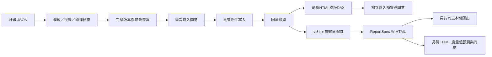

# M6：模型修改、Dashboard 計畫與 HTML 度量值

日期：2026-10-13。自有模型物件、Dashboard、固定／動態 HTML 度量值與 AI 結構化提案已接到 WPF。真實 TOM／XMLA 寫入與動態DAX計算未執行；驗證只改自製合成模型與未連線 TOM 物件。

## 操作與資料路徑

「更多來源與工具」提供兩個入口：

- **模型修改預覽**：輸入度量值陣列，或選擇 Measures／Columns／Relationships 混合 JSON（合計最多16個）；讀取完整定義、查看新增／更新差異，勾選當次同意後執行。[混合批次格式](model-object-writing.md)。
- **Dashboard 計畫**：輸入版本1計畫，指定 title、grouping、可選 period、最多6個 metrics 及最多8個 visuals。列0是分組；列1以後依指標順序。

Dashboard 的操作順序：



模型修改成功後，數值查詢與匯出尚未授權。後續查詢／匯出失敗不會刪除已驗證成功的度量值；只有寫入或回讀驗證失敗會嘗試還原。

內附合成計畫：

```json
{
  "Version": 1,
  "Title": "合成銷售 Dashboard",
  "Grouping": { "Table": "日期", "Column": "月份" },
  "Period": null,
  "Metrics": [{ "Table": "銷售", "Name": "SA_合成銷售", "Expression": "SUM('銷售'[金額])" }],
  "Visuals": [
    { "Id": "table", "Title": "月份與銷售", "Kind": "Table", "LabelColumn": null, "ValueColumn": null, "Aggregation": null },
    { "Id": "total", "Title": "回傳月份銷售合計", "Kind": "Kpi", "LabelColumn": null, "ValueColumn": 1, "Aggregation": "Sum" },
    { "Id": "trend", "Title": "月份銷售分布", "Kind": "BarChart", "LabelColumn": 0, "ValueColumn": 1, "Aggregation": null }
  ]
}
```

可選 `Period` 例如 `{"Field":{"Table":"銷售","Column":"日期"},"Start":"2026-01-01","End":"2026-04-01"}`。必須引用 Date／DateTime 欄；開始日包含、結束日排除，最多十年。計畫生成 `SUMMARIZECOLUMNS`、明確日期篩選及 `ORDER BY`；DAX 的實際語法／計算由 Power BI 服務端判定，本程式沒有通用 DAX 編譯器。查詢上限100列、64k bytes；截斷結果合計不代表完整母體。

合成 adapter 只接受固定示範查詢和上述一份已知 Dashboard 計畫，沒有模擬任意 DAX 或日期篩選；其他計畫需獨立測試模型驗收。

## 寫入契約

1. `DefinitionWrite` 預設關閉；AI provider 沒有 writer tool。桌面在使用者確認後才給當次能力。
2. 預覽綁定來源、metadata revision、**完整 TOM 定義的獨立 SHA-256 revision**、參數雜湊及 operation ID；變更計畫須重做。
3. 全模型度量值名稱檢查不區分大小寫。同名欄位、其他表上的度量值、沒有自有標記的度量值均拒絕。
4. 只寫 `SemanticAssistant.Owner=SemanticAssistant/v1` 和本次 operation ID 的物件；不以名稱前綴取代所有權判斷。
5. 重新連線後檢查完整版本，commit 前再次檢查授權與來源；寫後另讀模型，比對表／名稱／expression／owner／operation。
6. 重複 operation ID 不自動重做。工作階段 receipt 有上限，磁碟操作紀錄用 CreateNew 防止重啟後靜默重用 ID。
7. 寫入或回讀失敗，以獨立十秒 repair token 嘗試還原當次自有物件。若其他人已改該物件，保留修改並回報 `partial_failure`。
8. 取消／關閉視窗等待當次寫入與修復結束，再重新讀取來源；原生 SaveChanges 的取消屬 best effort，不保證 deadline 時遠端一定停止。

雲端預覽沿用唯讀 scope；實際當次同意後，writer 另外請求 `Dataset.ReadWrite.All`，驗證仍是原帳號與租用戶。這是本程式選擇的能力分離政策，不宣稱所有 XMLA 服務的權限判定完全由 OAuth scope 決定。還原僅嘗試 silent 取得已有寫入授權，不自動彈登入／同意視窗；workspace／Build／XMLA read-write 等服務端條件仍需滿足。

外部 XMLA 沒有本程式可保證的 compare-and-swap／跨連線原子交易。版本檢查不能排除檢查與 commit 之間的競態；十秒 repair token 也不能保證原生呼叫立即停止。嚴重失敗需人工核對 operation ID 的自有標記。

## 操作紀錄與修復

桌面寫入先把 intent flush 到 `%LOCALAPPDATA%\SemanticAssistant\write-journal\operation-<id>.jsonl`，成功／還原後記錄狀態。保存 operation ID、plan／source／revision 的雜湊、物件數、是否合成及時間；不保存模型名稱、物件名稱、DAX 原文或資料列。

- intent 建立失敗：不開始寫入。
- 回讀成功但結束紀錄寫入失敗：明確回報 `verified_journal_incomplete`，保留已成功的模型修改。
- `failed_rolled_back`：當次自有物件已還原並回讀驗證。
- `partial_failure` 或只有 intent：重新讀取獨立測試模型，按 operation annotation 核對；勿直接重試。
- 上限1000份紀錄，不自動刪除。封存後再繼續使用。

這是稽核狀態紀錄，**不是模型備份，也不是重啟後自動還原服務**。先前 expression 的還原快照只存在當次記憶體中；程序崩潰後需靠模型備份人工修復。

## HTML 度量值的實際範圍

固定 HTML 由已接受 QueryResult／ReportSpec 產生，經 HTML escaping 與 DAX 雙引號 escaping，限制8000字；保存固定查詢快照。動態 HTML 由 DashboardPlan 與已回讀指標編譯，生成受固定模板限制的DAX，按目前篩選內容取前100組；也支援四種視覺，但尚未在真實DAX引擎或HTML視覺驗收。[完整計算與提案契約](dynamic-html-dashboard-proposals.md)。兩種模式都未自動安裝視覺或編輯 PBIR 報表。

本機 HTML 匯出使用 `ArtifactWrite`；HTML 度量值另走 `DefinitionWrite` 的預覽／逐次同意／驗證／還原。同意本機檔案匯出不能授權模型修改。

AI的 `propose_dashboard` 已接入 MetadataRead 工具流程，只驗證計畫，不提供寫入能力。桌面從完整成功回合接受來源綁定提案，再走既有預覽與逐次同意。

仍待實作／驗收：原生報表視覺編輯的範圍決策、真實 Desktop／雲端寫入、動態DAX與HTML視覺，以及人工視窗取消驗收。writer 支援三種已列明物件，沒有涵蓋所有 TOM 物件。

依據：[Microsoft SUMMARIZECOLUMNS](https://learn.microsoft.com/en-us/dax/summarizecolumns-function-dax)、[DAX 語法與物件名稱](https://learn.microsoft.com/en-us/dax/dax-syntax-reference)。
