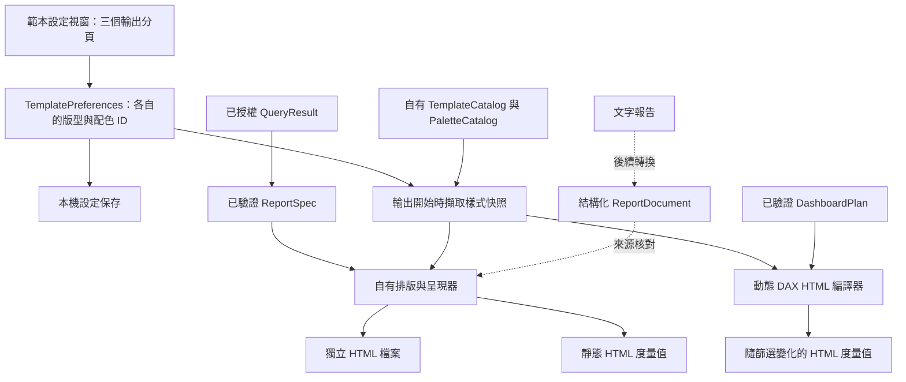

# 範本功能差距與修改評估

日期：2026-10-14。本文保留研究時的差距與設計；階段 A 已實作，使用與完成界線見 [report-templates.md](report-templates.md)。

## 結論

應將頂部「模板」改成報告輸出範本（Output Template）設定視窗：報告度量值、獨立 HTML、Dashboard 三個分頁，各自選擇版型與配色並持久保存。現有快捷提問可沿用左側引導式提問與首頁提示詞。

這個變更可沿用 WPF、既有設定保存、報告規格驗證與輸出器，無需依賴 ABI 的更新或複製其程式碼。要達成相應功能，需要同時接上輸出器；僅建立相似視窗不構成功能完成。

## 1. 證據與確定程度

### 使用者提供的畫面：已觀察

- 報告度量值分頁：「一頁報告－重點提煉」，描述將文字報告轉為 HTML 度量值；七組可見配色。
- 獨立 HTML 分頁：「經營快報二」，描述包含頂端導覽、總覽、原因拆解、重點洞察與建議；七組可見配色。
- Dashboard 分頁：「極簡商務風」，淺色看板；四組可見配色。
- 配色以色卡與勾選狀態呈現；底部有保存與取消。
- 截圖未展開版型選單，不能據此斷言所有版型名稱或數量。

### 本機靜態分析：已觀察

安裝目錄：`%LOCALAPPDATA%\Programs\ABI_Assistant`。

| 組件 | 本輪 SHA-256 | REA Evidence |
|---|---|---|
| AIAssistant.UI.dll | e56a472a125a2ba7e31f36f8de3c9d5406976d2fb00724cf4456562ac6fc5eb6 | ev_898d570c2965bb271d96dd1a02f71e3ce2d4c6dce9162e4d4476346579ee0b25 |
| AIAssistant.Core.dll | 3c1e624b828806b7f75a5f24b29cbdfc6e5a42b135f778c249f57bc4322be6a7 | ev_1ad58a6b0f591263a92f4b40c4731d4e1034f1cafeeb6bb6db87e9c34825863d |

REA 的中繼資料解析受到 64 MiB 表示預算限制，coverage=partial，沒有完整方法清單。沒有反覆重試同一解析。另使用現有 ILSpy 9.1 靜態反編譯 SettingsWindow；沒有執行 ABI 的目標程式碼。

本輪反編譯位於私人暫存目錄：
本機私人暫存中的 `AIAssistant.UI.SettingsWindow.decompiled.cs`（未納入公開原始碼）。

可見的流程與定位：

| 定位 | 觀察 |
|---|---|
| SettingsWindow 88–98 | 三組獨立版型清單，以及三組獨立配色清單 |
| SettingsWindow 727 起 | 依版型重新載入可用配色 |
| SettingsWindow 851 起 | 切換版型時刷新對應的配色選項 |
| SettingsWindow 2716、2753–2759 | 保存六個設定鍵，再呼叫 ConfigService.Save |
| SettingsWindow 2783 起 | 取消關閉視窗 |

六個設定鍵分別是 DefaultReportMeasureTemplateKey / PaletteKey、DefaultHtmlFileTemplateKey / PaletteKey、DefaultDashboardTemplateKey / PaletteKey。

先前 MainWindow 的靜態反編譯與本輪核對的組件雜湊相同；可沿用其呼叫鏈證據：

- 49587：MenuTemplates_Click → OpenSettings(3)。
- 72449–72463：GetConfiguredHtmlReportStyle / GetConfiguredHtmlFileStyle，讀設定、解析版型與配色。
- 44027–44037、44327–44388：文字報告轉換路徑先取得配置，呼叫 AI 建立結構化報告請求，亦有 TextReportToHtmlMeasureConverter 備援路徑。
- 56249–56253：Dashboard 讀取獨立版型與相容配色。

合理解讀：ABI 將內容轉換、版型與配色分層，並在不同輸出流程取用對應設定。Core 方法受保護，實際排版、轉換準確率與所有錯誤分支仍未知。

截圖提示「配置將自動保存」，但本輪可讀程式碼明確包含保存按鈕路徑。尚未用原生 UI 驗證每次選取是否立即寫入，不能承諾完全相同的自動保存語意。重建版建議明確採「保存套用、取消捨棄未保存修改」。

沒有讀取 ABI 使用者設定、API key、Power BI 資料列或執行 DAX；反編譯程式碼不納入本專案來源。

## 2. 重建版目前差距

| 功能 | 目前實作 | 修改需要 |
|---|---|---|
| 頂部範本入口 | MainWindow.xaml 的 ContextMenu；MainWindow.Shell.cs 的 OnShowTemplates | 改成三分頁設定視窗 |
| 報告版型保存 | AssistantSettings 只有預算、目前 AI 與 AI 模型清單 | 新增三組獨立輸出偏好 |
| HTML 檔案 | HtmlReportExporter → HtmlReportRenderer，固定 CSS / 圖表顏色 | 傳入已驗證的版型與配色 |
| 靜態 HTML 度量值 | DashboardPlans.HtmlMeasure 使用查詢快照 | 接報告度量值偏好；保留快照說明 |
| 動態 Dashboard HTML 度量值 | DynamicHtmlMeasureCompiler 固定樣式與圖表顏色 | 由 Dashboard 偏好產生 DAX 中的 HTML / SVG |
| 文字報告轉換 | 未建立獨立結構化報告文件；主要取用 latestResult | 新增報告文件與轉換器，並保留來源與不確定性 |
| 對話內報告預覽 | 報告模式驗證 HTML，但沒有嵌入完整互動 HTML 報告 | 若要求相同體驗，需增設預覽頁 |

現有資料流程仍可重用：QueryResult → ReportSpec → HTML 輸出。ReportSpec 定義視覺與資料欄位，尚未定義版型與配色。

## 3. 建議架構

### 設定與相容性

建議增加可選 TemplatePreferences 欄位，包含 ReportMeasure、HtmlFile、Dashboard；每個項目保存 TemplateId、PaletteId。舊設定缺少此欄位時使用預設，保持 AI 模型清單、憑證與預算。

- 版型與配色由本機目錄（Catalog）解析，確認輸出類型與配色相容。
- 未知 ID 拒絕套用，畫面提示，不默默換成另一種風格。
- 欄位只保存 ID，不保存外部 HTML、腳本或任意 CSS。
- 改偏好只影響後續輸出，既有檔案與模型度量值保留；更新度量值需再次產生、檢視與同意寫入。
- 每次產生輸出時固定樣式快照，避免工作途中變更配置造成預覽與寫入不同。
- 動態 HTML 的編譯與預覽雜湊須包含樣式選擇，避免舊預覽被沿用。

### 窗口與互動

- 三分頁名稱與輸出用途相符：報告度量值、獨立 HTML、Dashboard。
- 每頁包含用途說明、版型下拉選單、描述、配色色卡與合成資料預覽。
- 各頁保有獨立選取；切頁不會重設其他頁。
- 保存：驗證後寫入設定；取消：捨棄本次尚未保存的修改。
- 配置本身不連 AI、不查詢 Power BI、不寫入模型。
- 入口可命名「範本」；既有提示詞留在引導式提問，避免混淆。

### 版型的實際責任

版型必須影響版面結構，例如 KPI 的位置、單欄 / 多欄、段落順序與資料明細；配色影響背景、主色、圖表、文字與邊框。初始可提供每種輸出兩個自有版型，後續擴充。

獨立 HTML 可支援導覽與較完整章節；Power BI HTML 度量值優先採不依賴 JavaScript 的 HTML / CSS / SVG。七組一般配色與四組 Dashboard 配色可參照截圖中的分類自行設計，不聲稱其色碼與 ABI 完全一致。

## 4. 分階段實作與完成判準

### A：三分頁設定與實際樣式輸出

新增樣式目錄、設定資料、WPF 視窗；接上 HTML 檔案、靜態 HTML 度量值與動態 Dashboard HTML 編譯器。每類先兩個自有版型，提供合成預覽。

完成判準：
1. 三頁選擇相互獨立，保存後重啟仍保留；取消不改設定。
2. 修改版型後，輸出的布局確實不同；修改配色後，文字、卡片與圖表一致改色。
3. HTML 檔案、靜態度量值與動態度量值分別取得正確偏好。
4. 不改動既有 AI 設定、權限、來源版本與結果到期限制。
5. 生成的 HTML / DAX 仍遵守大小上限；超限明確拒絕。

### B：文字報告轉換與預覽

新增 ReportDocument（摘要、段落、證據引用、已知限制）及轉換流程；將有效 AI 文字內容與來源查詢分開保存。對話記錄包含工具事件與錯誤，不應直接把 Transcript 全文當成報告輸入。

完成判準：沒有來源的數字不升格為已驗證 KPI；無資料時可呈現文字報告，但不虛構圖表。AI 轉換仍走既有供應商外送授權與工具限制。

### C：Power BI 實際呈現

在合成模型確認寫入、回讀、篩選反應與 HTML 視覺呈現，再評估實際報表中的視覺相容性。HTML 度量值本身是文字輸出；要在 Power BI 呈現版面仍需能處理 HTML 的視覺，不能把度量值寫入成功等同完整報表視覺部署完成。

## 5. 取捨與下一步

| 項目 | 評估 |
|---|---|
| 配置視窗、配色、保存 | 工作量較低，既有 WPF 與設定層可沿用 |
| 三種輸出與預覽一致 | 工作量中等，跨 renderer、exporter、compiler 與 DashboardWindow |
| 文字轉換與證據對齊 | 工作量較高，涉及新文件模型與 AI 轉換 |
| 一比一完整渲染 | 尚無充分證據；Core 保護與不同 HTML 視覺能力影響可比性 |

建議下一步從 A 開始；完成範本選擇、保存與實際輸出後，再進 B。這是新增報告呈現能力，原有分析、查詢與修改度量值功能可持續使用。

研究階段未修改產品功能、未執行測試套件、未操作原生 ABI 視窗，亦未連線 AI 或 Power BI。上述完成判準為驗收計畫；後續階段 A 的實作與實際完成界線見使用文件。
